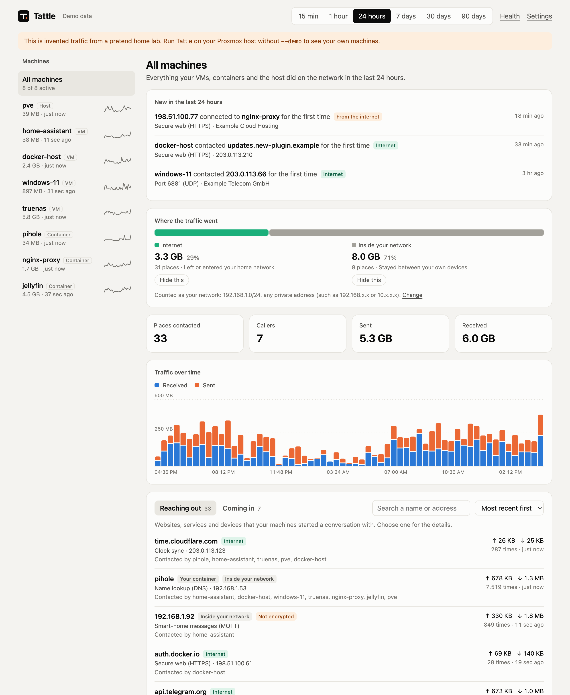
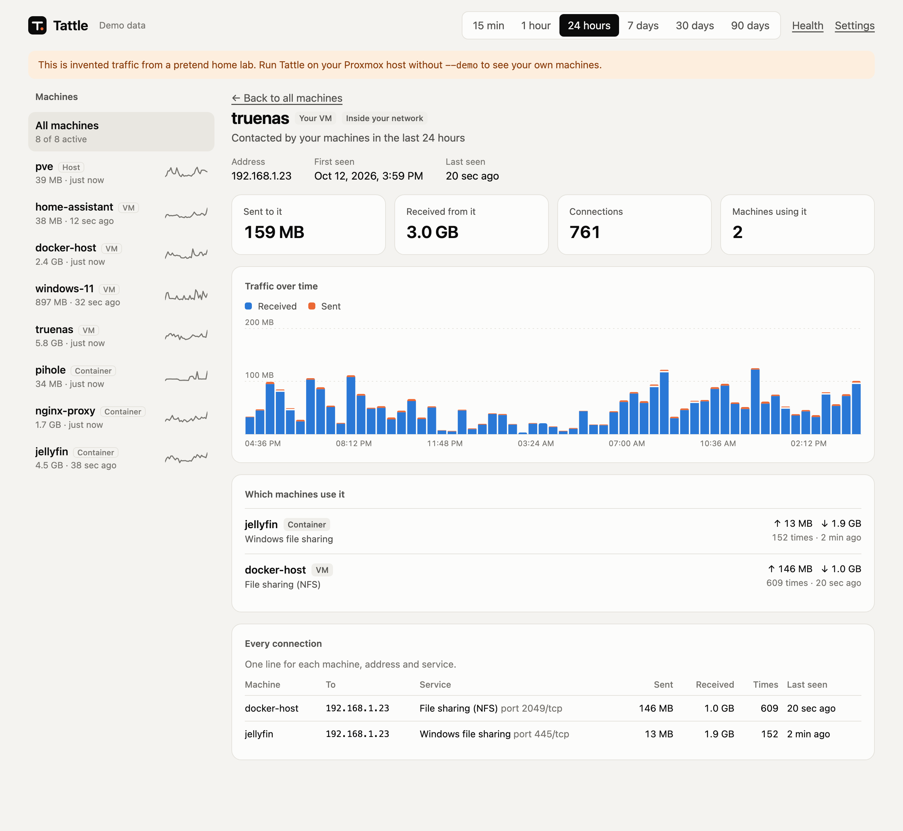
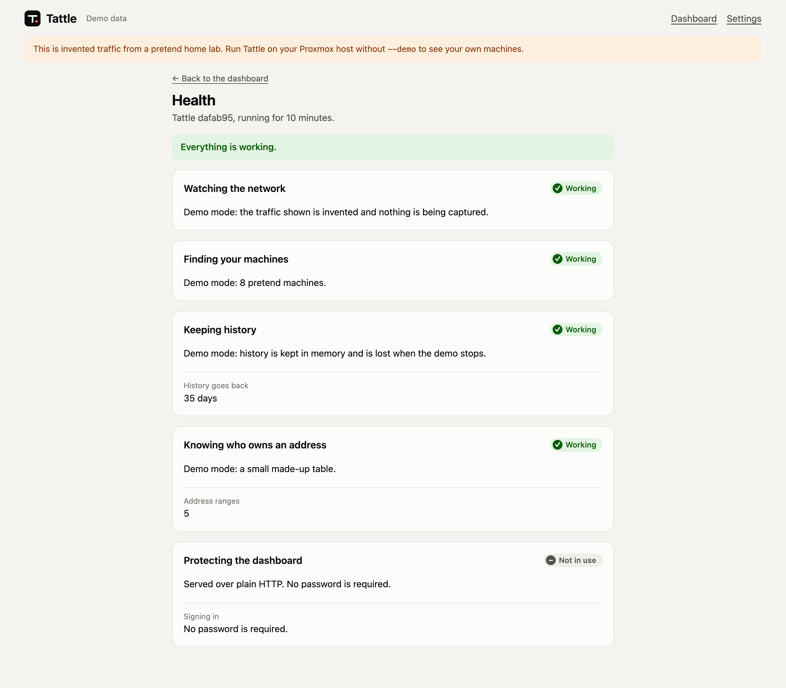

# Tattle

Tattle shows, in plain language, what every VM and container on a Proxmox
host is talking to: which websites and services they contact, who connects
to them, and how much data moves.

It is one program on the Proxmox host. Nothing is installed inside the
guests, and nothing leaves the host.



## What you get

- **Every machine by name.** VMs, containers and the host itself, read from
  Proxmox. No setup per guest.
- **Places, not packets.** "docker-host contacted registry-1.docker.io" with
  "Secure web (HTTPS)", not addresses and port numbers.
- **What's new.** The first time a machine contacts somewhere, or something
  connects to it, is listed at the top.
- **Internet or home network.** Every connection is labelled, and either
  side can be hidden.
- **Details one click away.** Who uses a destination, when, how much, and on
  which services.
- **Names for your devices.** Laptops, phones and televisions appear by the
  name they announce, or one you give them.
- **Who owns an address.** "Cloudflare, Inc." for an address that has no
  name, from a table kept on the host.
- **A health page** that says whether Tattle is working and what to do if
  not.

| A destination's detail page | The health page |
|---|---|
|  |  |

The screenshots show the built-in demo, which uses invented traffic.

## Install

On the Proxmox host, as root:

```bash
bash -c "$(curl -fsSL https://raw.githubusercontent.com/istorry/tattle/main/install.sh)"
```

That downloads the latest package for the machine, checks it against the
published checksums, installs it with `apt`, and starts it as a service.
[install.sh](install.sh) is short and worth reading before you run it; it
changes nothing else on the host.

If you would rather not pipe a script into a shell, download the package
from the [releases page](https://github.com/istorry/tattle/releases)
(`amd64` for almost every Proxmox machine) and install it yourself:

```bash
apt install ./tattle_0.1.0_amd64.deb
```

Either way, the install prints what to do next. Then:

1. Open `https://your-proxmox:8477`. Your browser warns about the
   certificate the first time, as it does for the Proxmox web panel,
   because Tattle generates its own. The connection is still encrypted.
2. Choose a password. Tattle asks for a setup code, which shows that the
   host is yours. It is in the service log:

   ```bash
   journalctl -u tattle | grep "setup code" | tail -1
   ```

Traffic appears within seconds. "What's new" stays quiet for the first day,
while Tattle learns what is normal for each machine.

To check a package you downloaded yourself, put `SHA256SUMS` from the
releases page beside it and run `sha256sum -c SHA256SUMS --ignore-missing`.

### Upgrading and removing

- **Upgrade:** run the install command again, or install a newer package.
  History, settings and the password are kept.
- **A particular release,** including a pre-release: put
  `TATTLE_VERSION=v0.1.0` in front of `bash` in the install command.
- **Remove:** run the uninstaller. It stops and removes Tattle, then asks
  whether to delete the history, the password and the certificate too.
  Keeping them means reinstalling carries on where it left off.

  ```bash
  bash -c "$(curl -fsSL https://raw.githubusercontent.com/istorry/tattle/main/uninstall.sh)"
  ```

  Without the script, `apt remove tattle` removes it and keeps those, and
  `apt purge tattle` deletes them as well.

## Try it without Proxmox

With Go and pnpm installed:

```bash
make demo
```

Then open http://127.0.0.1:8477. The demo shows invented traffic from a
pretend home lab, with no sign-in.

## What Tattle collects

Tattle records **who talked to whom, when, and how much**. For each
connection that is the machine, the other end's address and name, the
service (port), and the amount of data. It never records what was said: not
pages, not requests, not passwords, not file contents.

- **Everything stays on the host,** in one database under `/var/lib/tattle`.
- **Tattle makes no connections of its own.** There is no telemetry, no
  update check, and no lookups over the network. The dashboard loads nothing
  from other sites.
- **You decide how long it is kept,** and `apt purge tattle` deletes it all.

The full statement, including what a person with the dashboard password can
learn about the people using your network, is in
[docs/privacy.md](docs/privacy.md).

## Signing in and HTTPS

After setup, nothing but the sign-in page can be seen without the password,
and wrong guesses are limited. If you forget the password, run this on the
host and set a new one in the dashboard:

```bash
tattle reset-password
```

To check you are accepting the right certificate on the first visit, compare
the fingerprint your browser shows with the one in the log:

```bash
journalctl -u tattle | grep fingerprint | tail -1
```

### Avoiding the certificate warning

Use a certificate your browser already trusts. Tattle re-reads the files
when they change, so renewals need no restart:

```bash
tattle --tls-cert /path/to/fullchain.pem --tls-key /path/to/privkey.pem
```

If you set up a trusted certificate for the Proxmox web panel (Datacenter →
ACME), you can reuse it: the files are `/etc/pve/local/pveproxy-ssl.pem` and
`/etc/pve/local/pveproxy-ssl.key`.

Or put Tattle behind a reverse proxy that provides HTTPS, and have Tattle
listen only to the proxy:

```bash
tattle --http --listen 127.0.0.1:8477
```

With `--http`, passwords are only as protected as the connection in front
of Tattle.

To make options like these permanent, run `systemctl edit tattle` and
override `ExecStart`.

## Settings

The Settings link in the dashboard controls:

- what counts as your network (the host's own networks are detected, and
  you can add more),
- whether the dashboard hides traffic inside your network or internet
  traffic when it opens,
- how long history is kept: 90 days by default, the most recent 7 of them
  minute by minute and the rest as hourly totals,
- the password.

Settings are saved on the host and apply to everyone. The options below are
only what is needed to start Tattle; everything else is in Settings.

| Flag | Default | Meaning |
|---|---|---|
| `--listen` | `:8477` | Address for the dashboard |
| `--tls-cert`, `--tls-key` | generated | Your own HTTPS certificate and key |
| `--http` | off | Serve plain HTTP, for use behind an HTTPS reverse proxy |
| `--iface` | every `vmbr*` bridge | Bridges to watch, comma separated |
| `--ip-data` | `/usr/share/tattle/ip2asn.tsv.gz` | Table of who owns which internet addresses |
| `--db` | `/var/lib/tattle/tattle.db` | Where history is kept |
| `--pve-dir` | `/etc/pve` | Proxmox config directory |
| `--demo` | off | Show invented traffic, with no sign-in, over plain HTTP |
| `--demo-login` | off | With `--demo`, also require signing in |

## How it works

All guest traffic crosses a bridge on the host (`vmbr0`). Tattle listens on
the bridge and, for each connection, records who started it, where it went,
and how many bytes moved in each direction. Totals are stored per minute in
SQLite, and folded into one total per hour once they are a week old, which
takes a small fraction of the space.

- **Machine names** come from the VM and container config files in
  `/etc/pve`, matched to traffic by network card (MAC) address.
- **Destination names** come from three places, in order of preference: the
  server name in the HTTPS or HTTP/3 handshake, the `Host` header of plain
  HTTP, and DNS answers seen on the bridge.
- **Device names** for things that are not VMs or containers come from what
  the device announces about itself (mDNS and DHCP), or from a name you
  give it on its detail page. Your name always wins.
- **Address owners** come from the public-domain list published by
  [iptoasn.com](https://iptoasn.com), which is bundled with each release
  and uses about 25 MB of memory. Addresses inside your network are never
  looked up.
- **What's new** is the first time a machine deals with a place. Each
  machine is watched for a day before anything it does is called new, and
  places are remembered for over a year, so a monthly job is not announced
  every month.
- **Traffic the host forwards** for a guest, whether routed, masqueraded or
  port-forwarded, is counted once, for the guest.

## What it cannot see

- **The contents of encrypted connections.** For HTTPS, Tattle knows the
  site and the amount of data, not the pages or what was sent.
- **Names for some connections.** A destination shows as a bare address
  when the guest connects by address, or uses a protocol other than HTTPS,
  HTTP/3 or HTTP together with encrypted DNS.
- **Where a server is.** The country shown for a network is where the
  network is registered. A company registered in the United States may be
  answering you from a server anywhere.
- **Docker containers inside a VM.** They appear as the VM.
- **Guests that bypass the bridge**, such as a VM with a passed-through
  network card.

## Known limitations

- **Device names belong to an address, not to the device.** If your router
  hands a named device's address to a different device, the name moves with
  the address until the device announces itself again or you rename it.
  Giving devices fixed addresses in your router avoids this.
- **Masqueraded connections can occasionally show for the host as well.**
  Tattle recognises the host's translated copy of a guest's connection by
  its source port, so on the rare occasion the host has to pick a different
  port, that connection also appears under the host.
- **A guest's ping through a masquerading host** is counted for both.

## Contributing and security

- [CONTRIBUTING.md](CONTRIBUTING.md) covers building, testing and the layout
  of the code.
- [SECURITY.md](SECURITY.md) says how to report a vulnerability privately.
- [CHANGELOG.md](CHANGELOG.md) lists what changed in each release.

## Licence

Apache-2.0. See [LICENSE](LICENSE).
